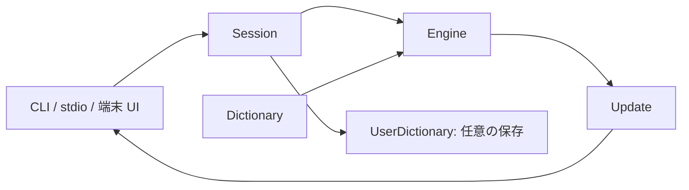

# アーキテクチャ

sumi の中心は、意味付けされたキーを入力し、確定差分と新しい状態を返す Engine です。
画面表示、端末のバイト列、ファイル保存、アプリケーション固有の操作は、それぞれ別の層で扱います。

## Engine

Engine は入力モードと変換段階を分けて保持します。
モードは ASCII、ひらがな、カタカナ、段階は直接入力、読みの入力、候補選択です。
辞書検索は同期処理なので、通信待ちを表す変換中の状態は設けません。

読みの状態では、語幹、送りキー、完成した送り仮名、未確定ローマ字を分けます。
候補選択の状態には元の読み、候補配列、選択番号をまとめ、取消し時に読みに戻せます。
候補を確定すると語幹と送り仮名を結合し、通常文字を続けて入力した場合は、確定後にその文字を再処理します。

`Update.committed` は、その操作だけの確定差分です。
`snapshot()` は過去の確定差分を再通知しません。
`preedit` は全体の表示用文字列で、呼出元が表示を構成し直せるよう、読みや送り仮名も別フィールドで返します。
`confirmed` は確定した辞書候補を表すデータで、Engine 自体は保存処理を行いません。

入力モードと変換状態の整合性は、通常の遷移テストに加え、混合入力のテストでも確認します。
候補選択中は候補配列が空でなく、選択番号が配列の範囲内で、未確定ローマ字は空になることを検査します。

## 辞書とセッション

Dictionary は UTF-8 の SKK 辞書をメモリへ読み込みます。
検索中にはファイルを開きません。
候補本文、注釈、送り仮名ブロックを分け、対応外の式を実行しないようにしています。
複数辞書は指定順で統合し、同じ本文の候補では先の辞書を優先します。

Session は Engine と Dictionary を所有し、任意の学習処理を追加します。
ユーザー辞書を指定しなければ、候補の確定でファイルを変更しません。
明示的な単語登録は、そのセッションの辞書へ追加できます。

UserDictionary はファイル保存だけを扱います。
安定した sidecar ファイルでロックし、保存直前に最新の辞書を読み直します。
内容を書いた一時ファイルを同期し、rename で置き換えてから親ディレクトリも同期します。
ロックが使用中の場合は待ち続けず、確定文字列を有効なまま保存失敗を通知します。
対応外のデータを落として上書きしないよう、学習用ファイルの対応範囲を検証します。

別のセッションが保存した変更は、次の保存時には取り込みますが、進行中の候補選択には割り込みません。
これにより、入力途中の候補番号が外部更新で変わることを避けます。

## CLI と通信

`kana` は、ローマ字をかなにするストリーム変換です。
SKK のモード切替や大文字による変換開始は扱わず、辞書も読みません。
`convert` は見出し語の候補検索、`serve --stdio` は逐次入力用のセッションです。
用途が異なるため、通常のテキスト出力と JSON Lines の操作形式を分けています。

stdio 通信は 1 プロセスで 1 セッションを保持します。
各要求を検証してから状態を変更し、ID を対応付けた応答を返します。
プロセス起動はセッション開始時だけで、キーごとの新規プロセスはありません。
ネットワークサーバー、常駐デーモン、複数セッションの多重化は導入していません。

アプリケーション向けの連携は別リポジトリで実装し、公開された CLI や stdio 通信を使います。
本体はエディタやターミナルマルチプレクサの操作を知りません。

## 端末 UI

端末 UI は Session の呼出元の一つで、確定した本文とカーソル位置を自分で保持します。
Engine は、確定した本文の編集や画面のカーソル位置を管理しません。
画面とキー入力には `/dev/tty` を使い、提出した本文だけを標準出力へ書きます。

POSIX 端末処理とシグナル処理は `terminal/sys.rs` に閉じ込めています。
端末設定を復元してから終了または一時停止し、再開時には入力を継続します。
本文の結合文字単位の編集、表示幅と折返し、キー列の解釈は別々にテストします。
端末機能を無効にしたビルドでは、この層とその依存を除外できます。

登録画面は、別の一時 Engine を使って元の読みを保持します。
登録語内の変換は一時的な操作とし、語全体を登録した時点で、元の送り仮名を付けて確定します。
入れ子の登録画面は現時点では提供しません。
